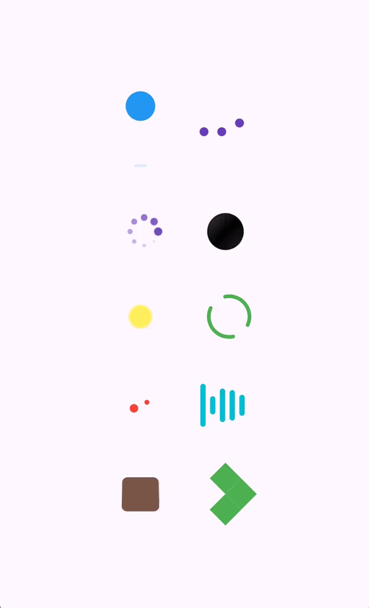

# Loader Gallery

A collection of customizable loading animations for Flutter applications.

`loader_gallery` provides reusable loading indicators with simple APIs, so you can add animated loading states to your app without implementing each animation from scratch.

## Features

- Multiple loading animations in one package
- Customizable colors and sizes
- Adjustable animation durations
- Simple, consistent API through `LoaderGallery`
- Lightweight Flutter widgets
- Example app for previewing the animations

## Installation

Add `loader_gallery` to your project's dependencies:

```bash
flutter pub add loader_gallery
```

Or add it manually to your `pubspec.yaml`:

```yaml
dependencies:
  loader_gallery: ^0.1.0
```

Then run:

```bash
flutter pub get
```

## Import

```dart
import 'package:loader_gallery/loader_gallery.dart';
```

## Usage

Use any loader through the `LoaderGallery` API:

```dart
import 'package:flutter/material.dart';
import 'package:loader_gallery/loader_gallery.dart';

class LoadingExample extends StatelessWidget {
  const LoadingExample({super.key});

  @override
  Widget build(BuildContext context) {
    return const Scaffold(
      body: Center(
        child:LoaderGallery.flipSquare(color: Colors.brown, size: 50),
,
      ),
    );
  }
}
```

## Available Loaders

The initial release includes these 10 loading animations:

1. `LoaderGallery.bouncingBall()`
2. `LoaderGallery.bouncingDots()`
3. `LoaderGallery.chasingDots()`
4. `LoaderGallery.coinFlip()`
5. `LoaderGallery.doubleBounce()`
6. `LoaderGallery.dualRing()`
7. `LoaderGallery.ellipseSwap()`
8. `LoaderGallery.equalizer()`
9. `LoaderGallery.flipSquare()`
10. `LoaderGallery.foldingCube()`

## Customization

Each loader supports its own set of customization options. Depending on the loader, you can adjust properties such as color, size, stroke width, dot size, and animation duration.

For example:

```dart
LoaderGallery.dualRing(
  color: Colors.purple,
  size: 50,
  strokeWidth: 4,
  duration: const Duration(milliseconds: 1200),
)
```

```dart
LoaderGallery.equalizer(
  color: Colors.green,
  size: 40,
  duration: const Duration(milliseconds: 1000),
)
```

## Preview



## Example

Explore the example application included in this repository to see the loaders in action.

## Requirements

- Flutter SDK: compatible with the version specified in `pubspec.yaml`
- Dart SDK: compatible with the version specified in `pubspec.yaml`

## License

This project is licensed under the MIT License. See the `LICENSE` file for details.
